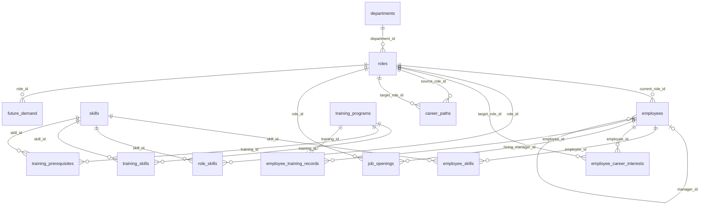

# WorkforceIQ

English | [繁體中文](README.zh-TW.md)

[**Live Demo**](https://workforceiq-demo.streamlit.app/)

[](https://github.com/harper-chen/WorkforceIQ/actions/workflows/tests.yml)

**WorkforceIQ is a human-centered workforce decision-support system that connects employee skills, career interests, internal learning resources, role requirements, and future workforce demand.**

It is designed to help three groups answer different but connected questions:

- **Employees:** What roles could I grow into next?
- **Managers:** Could this staffing need be addressed through internal mobility first?
- **HR / Workforce Planning:** Where are future workforce gaps likely to appear, and can current learning resources support the capabilities those roles require?

The system does not make promotion, transfer, hiring, or termination decisions on behalf of people. Instead, it brings fragmented workforce data together and turns it into transparent, explainable, and actionable decision support.

WorkforceIQ currently runs on **synthetic enterprise workforce data** and is built with Python, Pandas, SQL, SQLite, and Streamlit.

| Employee | Manager | HR |
|:---:|:---:|:---:|
|  |  |  |
| *Where could I grow, and what is still missing?* | *Can this opening be filled internally?* | *Can our learning catalog build the skills we will need?* |

**[Try the live demo →](https://workforceiq-demo.streamlit.app/)** Start with River Hsu (Employee), then Riley Chang (Manager). See the [Demo Scenario](#demo-scenario).

## Why WorkforceIQ?

Workforce-related information is often scattered across separate systems:

- Employee skill profiles
- Role requirements
- Career interests
- Internal training programs
- Job openings
- Future headcount plans

Each source is useful on its own, but many workforce decisions depend on how these sources relate to one another.

For example, knowing that a role will need more headcount is only part of the problem. A manager may also want to know whether interested internal employees are close enough to the role requirements, while HR may want to know whether the current learning catalog can actually build the capabilities those future roles require.

WorkforceIQ connects these pieces in one decision-support workflow.

### Where the idea came from

The idea comes from something I noticed during an internship at a large electronics company with a well-developed training program and a large workforce: employees improve their skills through courses, but the improvement is mostly known only to themselves and does little for their career development. Companies invest heavily in training, yet employees often cannot see where completing a course could take them. A learning catalog answers "what will this course teach me?" but not "which role does this prepare me for, and how far am I from it?"

It is also a staffing question. When training, skills, career interests and job openings are not connected, an organization may keep recruiting externally even though an internal employee could grow into the role with targeted development. Clear internal career pathways are not only an employee benefit; they can be part of a workforce strategy.

Connecting this information raises a second problem: should managers see every employee's career interests? An employee exploring another role privately may stop using a career-planning tool if their manager can see it. So career interests are **private by default**, and a manager sees one only when the employee opts in **and** it matches the exact role of an open requisition that manager owns.

WorkforceIQ therefore tries to hold three things together: help employees see how learning leads to roles, help managers and HR consider internal talent before defaulting to external hiring, and share only the minimum information a decision needs.

## Demo Scenario

For a consistent walkthrough of the prototype:

1. **Employee:** Start with **River Hsu — Business Analyst** in **My Skills** to review the skills currently recorded in his profile.
2. Open **Career Exploration** and select **Systems Analyst** to review his Skill Match, skill gaps, and learning options.
3. Switch to **Manager** and select **Riley Chang** to review the open **Systems Analyst** requisition and River's internal readiness.
4. Continue to **HR / Workforce Planning** to see how the same role appears in future workforce demand and capability-gap planning.

This walkthrough connects the employee, manager, and HR perspectives around the same workforce scenario.

## Screenshots

<details>
<summary>All screenshots, with explanations</summary>

### Employee — Career Exploration

River Hsu explores a move from Business Analyst to Systems Analyst. The overview surfaces recommended career options and current skill fit.


The role-detail view separates recorded gaps from missing evidence and links development needs to available internal learning options.


### Manager — Internal Staffing

Riley Chang reviews an open Systems Analyst requisition.


WorkforceIQ surfaces River Hsu as a visible internal candidate and recommends an `Internal Mobility` / `Train First` pathway based on the recorded evidence.


### HR — Workforce Planning

HR compares current and planned headcount to identify future workforce gaps.


The system then highlights capability needs that the current internal learning catalog cannot fully support.


</details>

## Quick Start

```bash
pip install -r requirements.txt
python database/rebuild_db.py      # build the demo database from schema + seed files
streamlit run app/app.py
python -m unittest discover -s tests   # optional: run the automated tests
```

## What the System Supports

<details>
<summary>Full feature walkthrough for the Employee, Manager, and HR workspaces</summary>

### Employee: Skills, Career Exploration, and Learning

The Employee workspace helps people understand where they are today and what they may need to develop for a future role.

In **My Skills**, employees can review their current role, recorded skills, and proficiency levels.

If a skill has no record, the system shows:

`Not recorded`

rather than assuming the employee does not have that capability.

In **Career Exploration**, the system compares an employee's skill profile with a target role's requirements and shows:

- Overall Skill Match
- Skills that already meet the role requirement
- Recorded skill gaps
- Skills that are not recorded yet
- Internal learning options for relevant gaps

Employees can also save roles they are interested in.

A saved career interest is `Private` by default. Employees can choose to make it `Visible to opening managers`.

In the current prototype, that interest appears in staffing only when the manager is responsible for an **open requisition** for the exact target role.

The **Learning Catalog** brings internal training programs together so employees can see what each course teaches, the proficiency level it can support, and any prerequisites.

### Manager: Internal Staffing Decision Support

The Manager workspace does not select candidates or produce a final ranking.

Visible candidates are listed in order of current Skill Match (ties are broken by fewer priority gaps, then fewer significant gaps) so the list is easy to read. That order is not a recommendation: the readiness label and the staffing route carry the meaning, and the decision stays with the manager.

Its purpose is to help answer a narrower question:

> Should this staffing need be explored through internal mobility first?

A manager's `open` and `paused` requisitions are both visible, but internal candidate search is disabled for a paused requisition until it becomes `open` again.

For employees who chose to share their interest in the role, WorkforceIQ evaluates:

- Skill Match
- Skill-profile evidence coverage
- Significant gaps
- Priority gaps

#### Evidence Coverage

Evidence coverage measures how much of the required role-skill profile is actually recorded for the employee:

```text
number of required skills with a record
---------------------------------------
total number of required skills
```

Coverage is not weighted by skill importance.

#### Internal Readiness

The prototype uses the following heuristic defaults:

| Readiness | Evidence coverage | Skill Match | Priority gaps | Significant gaps |
|---|---:|---:|---:|---:|
| Ready Now | ≥ 70% | ≥ 80% | 0 | ≤ 1 |
| Train First | ≥ 70% | ≥ 60% | ≤ 1 | No explicit cap |
| Larger development gap | ≥ 70% | Does not meet the Ready Now or Train First criteria | — | — |
| Not assessed | < 70% | Not assessed | — | — |

A candidate may still fall into `Larger development gap` even when the Skill Match reaches one of the score thresholds if other readiness conditions are not met, such as having too many priority gaps.

These thresholds are **prototype-level heuristics**. They have not been validated or calibrated against real internal-mobility outcomes.

#### Staffing Route

The manager sees one of three staffing routes.

**Internal Mobility**

Suggested when at least one visible candidate is `Ready Now` or `Train First`.

**More Evidence Needed**

Suggested when no candidate currently qualifies for internal mobility, but at least one candidate has insufficient skill evidence for a reliable readiness assessment.

This prevents missing data from being treated as evidence that the employee is not a fit.

**External Hire**

Suggested when all visible candidates have sufficient skill evidence and none is `Ready Now` or `Train First`.

It is also suggested when no employee has shared a visible career interest in that exact role.

### HR: Workforce Planning and Learning Coverage

The HR workspace stays at the aggregate level rather than evaluating individual candidates.

It focuses on two questions.

#### Where could future workforce gaps appear?

For each role, the system compares current and planned headcount:

```text
Workforce Gap = max(Planned Headcount - Current Headcount, 0)
```

HR can adjust planned headcount to explore how future staffing needs change.

#### Can current internal learning support those future roles?

For roles with a workforce gap, WorkforceIQ links workforce demand with role-skill requirements and the internal training catalog:

```text
Gap Roles
→ Role Skill Requirements
→ Internal Training Coverage
→ Capability Development Priorities
```

For each required skill, the system looks at the **highest training outcome level** currently available in the internal catalog.

If that level is still below what a gap role requires, the skill is surfaced as a capability development priority.

This means workforce planning can go beyond:

> Which roles may become short-staffed?

and also ask:

> Can our current learning system build the capabilities those roles will need?

</details>

## Skill Matching Logic

WorkforceIQ uses a transparent, rule-based matching approach.

For each skill:

```text
min(employee proficiency / required proficiency, 1)
```

Overall Skill Match:

```text
Σ(importance × skill match)
---------------------------
Σ(importance)
```

Two principles are especially important.

### Overperformance does not cancel another gap

Exceeding the requirement in one skill does not compensate for missing capability elsewhere.

Each skill's contribution is capped at 100%.

### Lack of evidence is not evidence of lack

If an employee has no record for a required skill, the calculation gives that skill 0 demonstrated match credit.

The UI still shows `Not recorded`.

This distinction matters because missing evidence and evidence of low proficiency are not the same thing.

## Human-Centered Design Principles

WorkforceIQ is designed to support human judgment rather than replace it.

**Employee agency**  
Employees decide whether their saved career interests are visible to opening managers.

**Data minimization**  
Managers only see career interests relevant to staffing needs they are responsible for and that employees explicitly chose to share. HR workforce planning stays at the aggregate level.

**Explainability**  
Skill Match, skill gaps, readiness, and staffing routes come from explicit rule-based logic that can be inspected and discussed.

**Human oversight**  
The system does not automatically promote, transfer, hire, reject, or terminate employees. Final decisions remain with people.

**Evidence-aware decisions**  
When information is incomplete, the system can return `Not assessed` or `More Evidence Needed` instead of producing a falsely precise judgment.

## Current Privacy and Access Model

The current visibility rules are implemented through:

- Database queries
- Application logic
- UI flow

For a career interest to appear in the manager candidate list, all of the following must be true:

- The employee set visibility to `opening_managers`
- The target role exactly matches the opening's role
- The opening belongs to the current manager
- The opening status is `open`
- The employee is not the opening's hiring manager

This is still a prototype.

It does **not** yet implement production-grade authentication, authorization, or role-based access control.

The Employee, Manager, and HR workspace switcher in the sidebar is therefore for development and demonstration only.

## Technical Architecture

Main technologies:

- Python
- Pandas
- SQL
- SQLite
- Streamlit

Main data entities include:

- Departments
- Roles
- Skills
- Employees
- Employee skills
- Role skill requirements
- Career interests
- Career paths
- Job openings
- Training programs
- Training prerequisites
- Training records
- Future workforce demand

### Data model

The schema has 14 tables. This overview is generated from `database/schema.sql`:



Column-level diagrams for each area are in [`docs/er-diagram.md`](docs/er-diagram.md). [`docs/schema.dbml`](docs/schema.dbml) can be pasted into [dbdiagram.io](https://dbdiagram.io) for a polished image. Regenerate both with `python database/generate_er_diagram.py`; a test fails if they fall out of date.

### Project structure

```text
WorkforceIQ/
├── app/
│   ├── app.py
│   ├── db.py              # SQL queries and per-visitor database copies
│   ├── readiness.py       # evidence coverage, internal readiness, staffing route
│   ├── planning.py        # workforce gap and capability-coverage calculations
│   └── views/
│
├── database/
│   ├── schema.sql
│   ├── seed_*.sql
│   ├── rebuild_db.py
│   └── generate_er_diagram.py
│
├── tests/
│
├── docs/
│   ├── er-diagram.md
│   ├── schema.dbml
│   └── images/
│       ├── employee-career-overview.png
│       ├── employee-career-detail.png
│       ├── manager-opening.png
│       ├── manager-staffing-decision.png
│       ├── hr-workforce-demand.png
│       └── hr-capability-gaps.png
│
├── .github/workflows/tests.yml
├── SQL/
└── requirements.txt
```

## Reproducible Database

The generated SQLite database is not committed to the repository.

If `database/workforceiq.db` is missing, the application automatically bootstraps a fresh demo database from the committed schema and seed files. This allows a fresh portfolio deployment to start without committing a writable SQLite database.

The database can also be rebuilt manually:

```bash
python database/rebuild_db.py
```

To validate the rebuild without replacing the existing database:

```bash
python database/rebuild_db.py --dry-run
```

To rebuild while preserving existing saved career interests:

```bash
python database/rebuild_db.py --keep-interests
```

If an existing database is present, the rebuild process creates a backup before replacing it.

The rebuild script also checks:

- Database integrity
- Foreign-key consistency
- Key schema constraints
- Seed-data consistency

### One private copy per visitor

`database/workforceiq.db` is a read-only baseline: the running app never writes to it. Each visitor session works on its own temporary copy, so saving a career interest or changing its visibility in one browser tab does not affect anyone else.

**Demo controls → Reset demo data** restores the seeded career interests and visibility settings in the visitor's own copy only. Copies live in the system temp folder and are removed automatically after about a day of inactivity.

## Why Rule-Based Instead of Machine Learning?

WorkforceIQ currently uses rule-based decision logic rather than predictive machine learning.

This is not because machine learning is inherently unsuitable for workforce analytics.

The current project uses synthetic workforce data and does not have real historical outcomes such as:

- Internal-mobility success
- Hiring outcomes
- Longitudinal employee performance

Without those outcomes, there are no reliable prediction targets or validation labels.

A predictive model could still be built, but there would be no sound way to determine whether it actually predicts employee readiness or successful internal mobility.

For this prototype, transparent rules that can be directly inspected are therefore more appropriate for the available evidence.

If sufficiently large, properly governed historical data becomes available in the future, rule-based, statistical, and machine-learning approaches could then be compared empirically.

## Testing

The decision logic is covered by automated tests that run on every push (see the badge at the top):

```bash
python -m unittest discover -s tests
```

| Area | What is checked |
|---|---|
| Skill Match and gaps | Weighted match, the 100% cap per skill, gap and priority-gap counts, and missing records scored as 0 without being counted as gaps. Checked against a small database whose answers are worked out by hand. |
| Manager visibility | Only interests that the employee made visible, in the exact role of an open requisition owned by the requesting manager, are shown. Private interests, other roles, paused openings and the hiring manager are excluded. |
| Readiness and staffing route | Every threshold at its boundary (70% evidence coverage, 80% and 60% Skill Match, priority and significant gap limits) and each staffing route. |
| Workforce planning | `max(planned − current, 0)` and which required skills the internal catalog cannot cover. |
| Per-visitor database | Visitors get separate copies, saves and resets stay private, and stale copies are cleaned up. |
| Seeded demo | The database rebuilds with every integrity check passing, and the README walkthrough (River Hsu → Riley Chang → `Internal Mobility` / `Train First`) still holds. |
| Documentation | The ER diagrams match `schema.sql`. |

The Streamlit screens themselves are not covered by automated tests; they are verified through manual QA.

## Limitations

WorkforceIQ is currently a prototype.

Its main limitations are:

- **Synthetic data:** The workforce data is synthetic and cannot be used to infer real organizational talent patterns or workforce outcomes.
- **Heuristic thresholds:** Readiness thresholds have not been validated or calibrated against real mobility outcomes.
- **No production authentication or RBAC:** Workspace visibility is currently controlled through query logic, application logic, and UI flow.
- **No outcome validation:** There are no real mobility, hiring, or performance labels with which to test predictive validity.
- **Tests cover the logic, not the interface:** The decision rules, visibility rules, per-visitor databases and database rebuild are covered by automated tests (see [Testing](#testing)). The Streamlit screens are verified through manual QA.
- **Demo data is temporary:** Each visitor's private copy is tied to the browser session. Refreshing the page, or the hosting service restarting the app, starts a new copy from the seeded data, which works like an automatic reset.
- **Prototype deployment:** The system is intended as a local and portfolio prototype rather than a production HR platform.

## Project Scope

WorkforceIQ currently focuses on:

- Workforce data integration
- Skills intelligence
- Career mobility
- Internal staffing
- Workforce planning
- Learning coverage
- Explainable decision support
- Human-in-the-loop decision support

It deliberately does not attempt to become a full HRIS or add predictive features that cannot be validated with the available data.

The core question of the project is not:

> "Can we add more AI?"

It is:

> **Given the evidence available, what transparent and explainable decision support can the system provide without making claims that go beyond what the data can support?**
