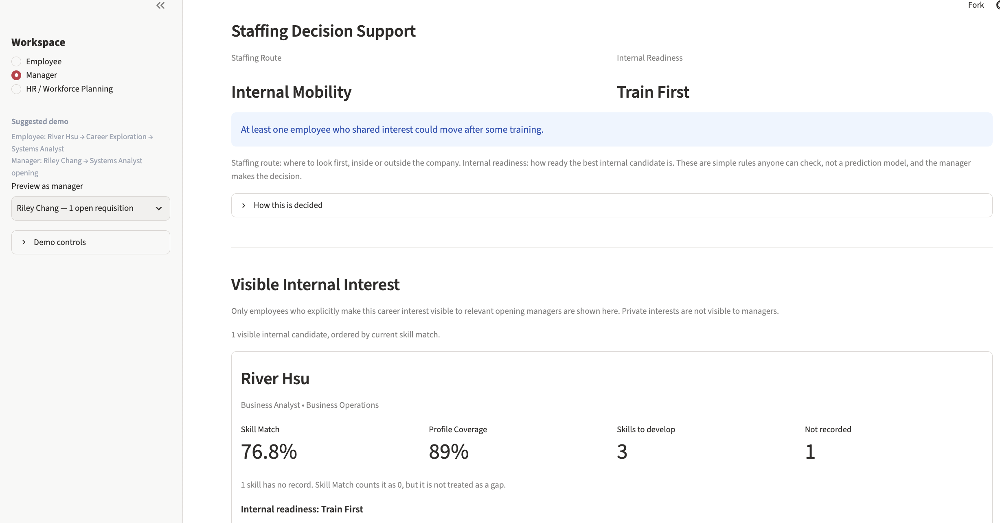
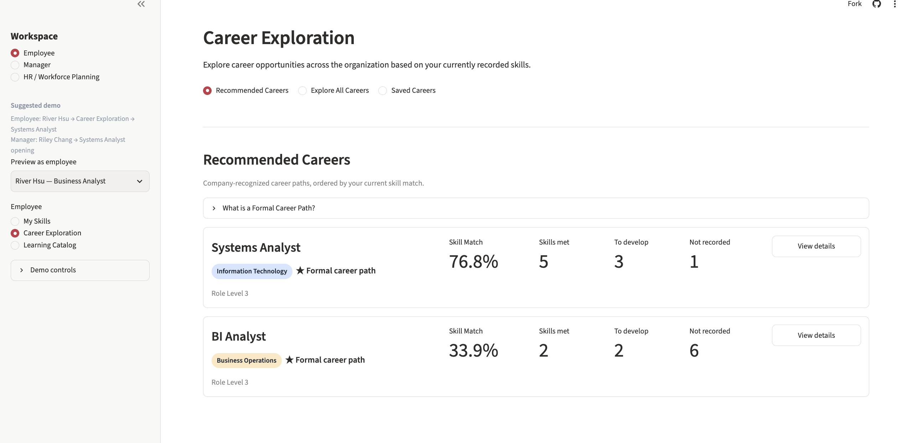
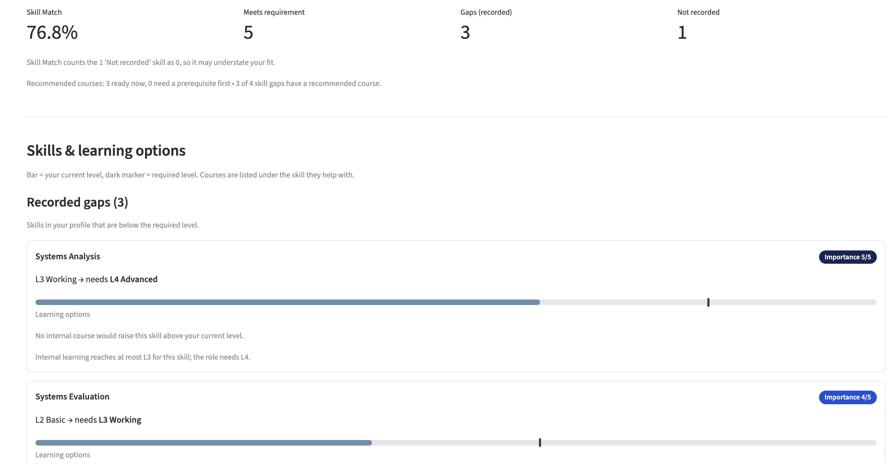
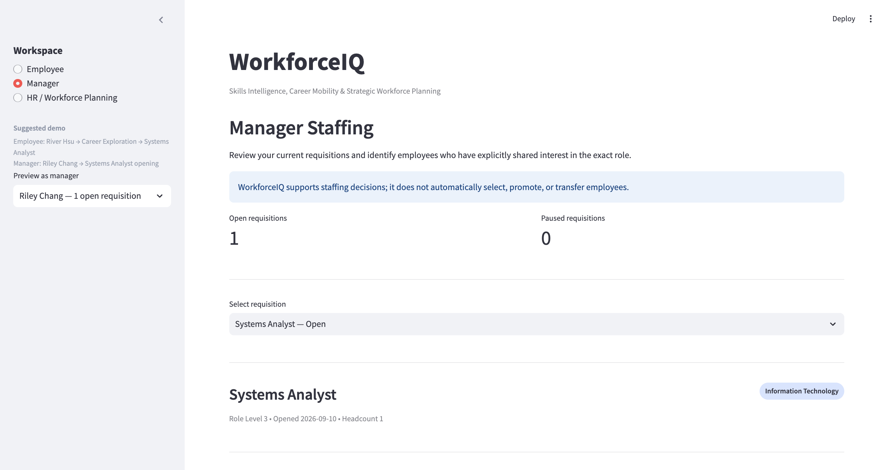
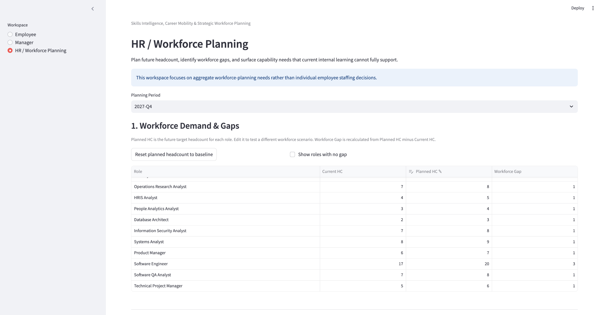
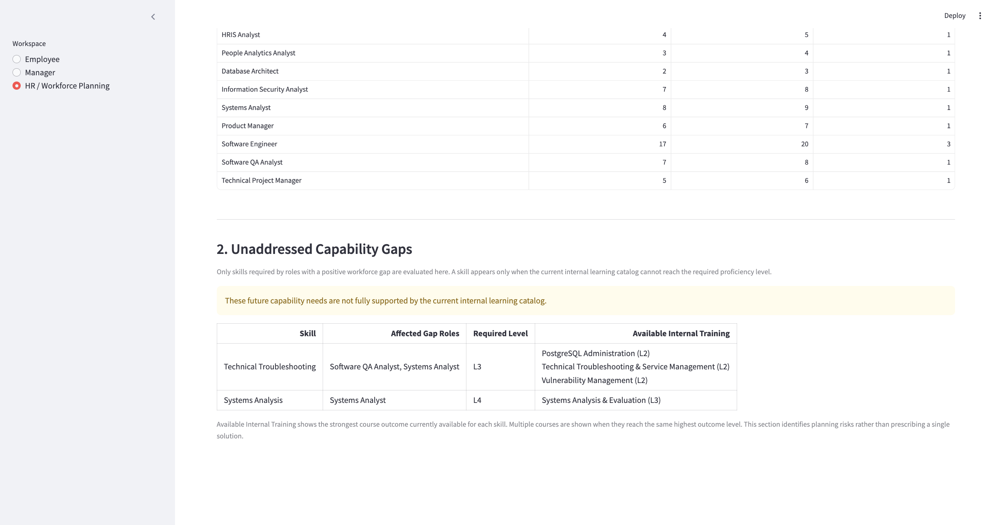
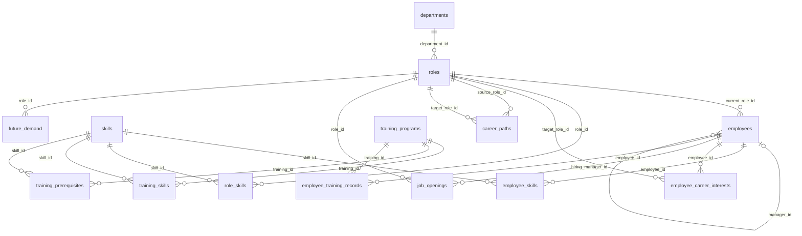

# WorkforceIQ

English | [繁體中文](README.zh-TW.md)

[](https://github.com/harper-chen/WorkforceIQ/actions/workflows/tests.yml)

A workforce decision-support app that connects employees' skills, career interests and training with job openings and future headcount plans, so organizations can grow talent internally before hiring from outside, without taking decisions away from people.

**[Try the live demo →](https://workforceiq-demo.streamlit.app/)** No sign-up needed. Start with River Hsu (Employee), then Riley Chang (Manager); see [Try the demo](#try-the-demo).

<p align="center">
  <a href="https://workforceiq-demo.streamlit.app/"></a>
</p>

<p align="center"><em>Manager view: an employee who chose to share interest in the role, with a readiness label and a suggested staffing route.</em></p>

## The problem

The idea came from an internship at a large electronics company with a well-developed training program. I noticed three disconnected pieces:

1. **Training does not lead anywhere visible.** Employees take courses and improve their skills, but a course catalog answers "what will this teach me?", not "which role does this prepare me for, and how far am I from it?"
2. **Internal talent is easy to miss.** When skills, career interests and job openings live in separate places, a company may hire externally even though an employee could grow into the role with targeted training.
3. **Sharing career interests feels risky.** An employee exploring another team may stop using a career tool if their manager can see everything.

## What this project changes

| | Before | With WorkforceIQ |
|---|---|---|
| **Employees** | Know what a course teaches, but not where it could take them | See how well their recorded skills match a target role, which gaps remain, and which internal courses close them |
| **Managers** | Fill an opening without knowing who inside is interested and close | See employees who chose to share interest in that exact role, each with a readiness label and a suggested route: internal mobility, more evidence needed, or external hire |
| **HR** | Plan headcount and training separately | See which roles will be short-staffed and which required skills the current training catalog cannot build at all |
| **Privacy** | Interest in another role is either hidden or exposed | Career interests are private by default; a manager sees one only when the employee opts in and it matches an open position that manager owns |

The app never promotes, transfers, hires or rejects anyone. It brings scattered information together and explains its suggestions; people make the decisions.

## What I built

I designed and built WorkforceIQ on my own, from the data model to the interface, using AI coding assistants along the way, for example to help write the automated tests:

- **A relational database of 14 tables** (employees, skills, roles, training, career interests, openings, future demand), filled with synthetic data for 100 employees, 16 roles, 98 skills and 67 training programs, with integrity checks on every rebuild.
- **Transparent matching and readiness rules** written in SQL and Python, kept separate from the interface so each rule can be tested on its own.
- **Three workspaces in Streamlit** for employees, managers and HR, with privacy rules enforced in the database queries.
- **111 automated tests** that run on every push (Python 3.11 and 3.12), including hand-worked examples for the matching math and every readiness threshold at its boundary.

## How it works

The demo follows one story across the three workspaces.

**1. An employee explores a next role.** River Hsu, a Business Analyst, opens Career Exploration and sees recommended next roles (formal career paths from his current role first), each with how well his recorded skills match it.



**2. He sees the gaps and how to close them.** The detail view separates real skill gaps from skills that are simply not recorded yet, and links each gap to internal courses (with their prerequisites). He has saved Systems Analyst as a career interest and made it visible to opening managers, while his other saved interest, BI Analyst, stays private.



**3. A manager reviews an opening.** Riley Chang has an open Systems Analyst position.



**4. The app suggests looking inside first.** Because River shared his interest, Riley sees him with a `Train First` readiness label, and the suggested route is `Internal Mobility`. The decision stays with Riley.


**5. HR sees the bigger picture.** HR adjusts planned headcount to see which roles will be short-staffed.



**6. HR checks whether training can close the gaps.** The app lists required skills that no internal course teaches to the level a role needs, and the roles affected.



## Design choices

Each of these comes from a risk I wanted the system to avoid:

- **Missing data is not a weakness.** If a skill is not recorded, the app shows `Not recorded` instead of treating it as a gap or a skill to develop. When too little is recorded to judge (under 70% of a role's required skills), or when the missing records alone could change the result, readiness is `Not assessed` and the route can become `More Evidence Needed`, rather than suggesting an external hire. A course prerequisite with no record does not lock the course; the employee is asked to confirm it instead.
- **One strength cannot hide another gap.** Each skill counts for at most 100% of its requirement, so being excellent at one skill does not cancel a missing one.
- **Privacy by default, sharing by choice.** Career interests start private. Managers see only what employees chose to share, only for the exact role of an open position they own, and HR planning stays at the aggregate level.
- **No ranking that decides for people.** The candidate list is sorted for readability, but the readiness label and the explanation carry the meaning, and the app never makes the decision.
- **Rules instead of machine learning, on purpose.** With synthetic data there are no real outcomes (such as successful transfers) to train or validate a model against. Rules anyone can read and question are more honest for the evidence available.

## Try the demo

1. Open the **[live demo](https://workforceiq-demo.streamlit.app/)** and choose the **Employee** workspace with **River Hsu**. Review his skills in **My Skills**.
2. Open **Career Exploration** and select **Systems Analyst** to see the match, the gaps and the suggested courses.
3. Switch to the **Manager** workspace and select **Riley Chang** to review the open Systems Analyst position and River's readiness.
4. Switch to **HR / Workforce Planning**, change some planned headcounts, and review the capability gaps.

Each visitor works on a private copy of the database, so your changes do not affect anyone else. **Demo controls → Reset demo data** restores the starting state.

The interface is also available in Traditional Chinese: add `?lang=zh` to the URL ([Chinese demo](https://workforceiq-demo.streamlit.app/?lang=zh)) or use the language switch at the top of the sidebar. English is always the default. Demo data such as names of people, roles, skills and courses stays in English.

## Limitations

WorkforceIQ is a prototype.

- **Synthetic data:** the workforce data is invented and cannot show real organizational patterns.
- **Untested thresholds:** the readiness thresholds are reasonable defaults, not calibrated against real internal-mobility outcomes.
- **No real login:** switching between Employee, Manager and HR is for demonstration; there is no production authentication or role-based access control.
- **Tests cover the logic, not the screens:** the rules, privacy queries and database rebuild are tested automatically; the Streamlit screens are checked by hand.
- **Demo data is temporary:** refreshing the page or a restart of the hosting service starts a fresh copy of the seeded data.

## Technical details

Built with Python, pandas, SQL, SQLite and Streamlit.

<details>
<summary>Skill matching and readiness rules</summary>

**Skill Match.** For each required skill:

```text
min(employee proficiency / required proficiency, 1)
```

Overall Skill Match, weighted by each skill's importance to the role:

```text
Σ(importance × skill match)
---------------------------
Σ(importance)
```

A skill with no record gets 0 match credit in this calculation, but the interface labels it `Not recorded` and does not count it as a gap or a skill to develop. Because a 0 can only pull the score down, the app also computes a **best-case Skill Match** in which every not-recorded skill meets its requirement.

**Evidence coverage** is the share of a role's required skills that have a record for the employee (not weighted by importance).

**Internal readiness** (prototype defaults in `app/readiness.py`):

| Readiness | Evidence coverage | Skill Match | Priority gaps | Significant gaps |
|---|---:|---:|---:|---:|
| Ready Now | ≥ 70% | ≥ 80% | 0 | ≤ 1 |
| Train First | ≥ 70% | ≥ 60% | ≤ 1 | No cap |
| Larger development gap | ≥ 70% | Does not meet the rows above | — | — |
| Not assessed | < 70% | Not assessed | — | — |

A **significant gap** is a recorded skill that is 2 or more levels below the requirement; a **priority gap** is a significant gap in one of the role's most important skills (importance 4–5). Skills with no record are never counted as either.

With at least 70% coverage, readiness is checked twice: with the recorded Skill Match and with the best-case Skill Match (gaps count only recorded skills both times). If the two results differ, the missing records are deciding the result:

- Larger development gap on recorded skills, but Train First or better in the best case → `Not assessed`.
- Train First on recorded skills, but Ready Now in the best case → stays `Train First`, with a note that recording the missing skills could show the employee is Ready Now.

**Staffing route** for an opening:

- **Internal Mobility:** at least one visible candidate is `Ready Now` or `Train First`.
- **More Evidence Needed:** no candidate qualifies, but at least one is `Not assessed` (too little recorded, or the missing records could change the result).
- **External Hire:** every visible candidate was assessed and none qualifies, or no employee has shared interest in that role.

Visible candidates are listed by Skill Match, then fewer priority gaps, then fewer significant gaps. A manager's paused openings are listed, but candidate search is disabled until the opening is open again.

</details>

<details>
<summary>Privacy and access model</summary>

A career interest appears in a manager's candidate list only when all of these are true (enforced in the SQL query in `app/db.py` and covered by tests):

- the employee set its visibility to `opening_managers`
- the target role exactly matches the opening's role
- the opening belongs to the current manager
- the opening's status is `open`
- the employee is not the opening's hiring manager

This is a prototype: the workspace switcher is for demonstration and there is no production authentication or role-based access control.

</details>

<details>
<summary>Workforce planning calculations</summary>

For each role, using the planned headcount HR enters:

```text
Workforce Gap = max(Planned Headcount - Current Headcount, 0)
```

For learning coverage, the app checks the requirements of **every** role against the training catalog. For each required skill it finds the highest level any internal course teaches; if that is below what a role requires, the skill is listed as a capability gap with the roles it affects. This check does not depend on the headcount scenario. The logic is in `app/planning.py`.

</details>

<details>
<summary>Data model</summary>

The schema has 14 tables. This overview is generated from `database/schema.sql`:



Column-level diagrams are in [`docs/er-diagram.md`](docs/er-diagram.md), and [`docs/schema.dbml`](docs/schema.dbml) can be pasted into [dbdiagram.io](https://dbdiagram.io). Regenerate both with `python database/generate_er_diagram.py`; a test fails if they fall out of date.

</details>

<details>
<summary>Run it yourself, database rebuild and per-visitor copies</summary>

```bash
pip install -r requirements.txt
python database/rebuild_db.py            # build the demo database from schema + seed files
streamlit run app/app.py
python -m unittest discover -s tests     # run the automated tests
```

The SQLite database is not committed. If `database/workforceiq.db` is missing, the app builds it from the schema and seed files on first start.

- `python database/rebuild_db.py --dry-run` validates a rebuild without replacing the database.
- `python database/rebuild_db.py --keep-interests` rebuilds while keeping saved career interests.
- An existing database is backed up before it is replaced.
- Each rebuild checks database integrity, foreign keys, key schema constraints and seed-data consistency.

The rebuilt database is a read-only baseline: the running app never writes to it. Each visitor session gets its own temporary copy, so saving a career interest in one browser tab does not affect anyone else. Copies are deleted after about a day of inactivity.

</details>

<details>
<summary>Automated tests</summary>

| Area | What is checked |
|---|---|
| Skill Match and gaps | Weighted match, the 100% cap per skill, gap and priority-gap counts, and missing records scored as 0 without being counted as gaps, checked against a small database whose answers are worked out by hand |
| Manager visibility | Only interests the employee made visible, in the exact role of an open opening owned by that manager; private interests, other roles, paused openings and the hiring manager are excluded |
| Readiness and staffing route | Every threshold at its boundary, each staffing route, and the best-case check that keeps missing records from deciding a result |
| Course prerequisites | A prerequisite recorded below the minimum locks a course; one with no record only asks the employee to confirm it |
| Workforce planning | `max(planned − current, 0)` and which required skills the catalog cannot cover |
| Per-visitor database | Separate copies per visitor, private saves and resets, and cleanup of old copies |
| Seeded demo | The database rebuilds with every integrity check passing, and the demo story (River Hsu → Riley Chang → `Internal Mobility` / `Train First`) still holds |
| Documentation | The ER diagrams match `schema.sql`, and the example queries in `SQL/` still run |

</details>

<details>
<summary>Project structure</summary>

```text
WorkforceIQ/
├── app/
│   ├── app.py
│   ├── db.py              # SQL queries and per-visitor database copies
│   ├── readiness.py       # evidence coverage, internal readiness, staffing route
│   ├── planning.py        # workforce gap and capability-coverage calculations
│   └── views/             # Employee, Manager and HR screens
├── database/
│   ├── schema.sql
│   ├── seed_*.sql
│   ├── rebuild_db.py
│   └── generate_er_diagram.py
├── tests/
├── docs/
│   ├── er-diagram.md
│   ├── schema.dbml
│   └── images/
├── SQL/
├── .github/workflows/tests.yml
└── requirements.txt
```

</details>
