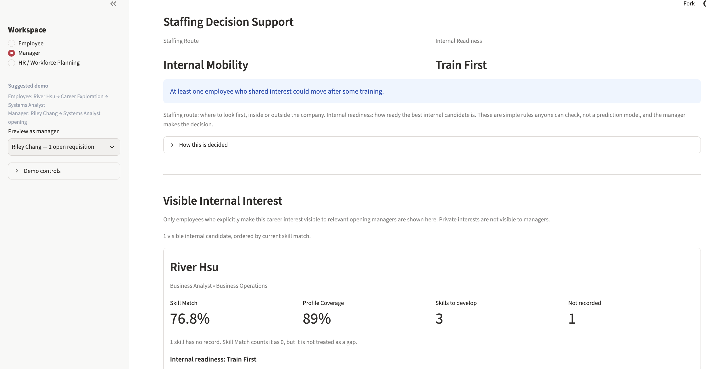
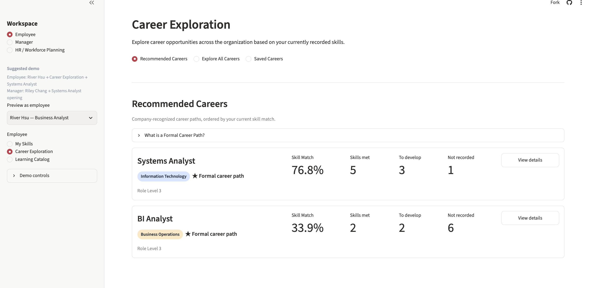
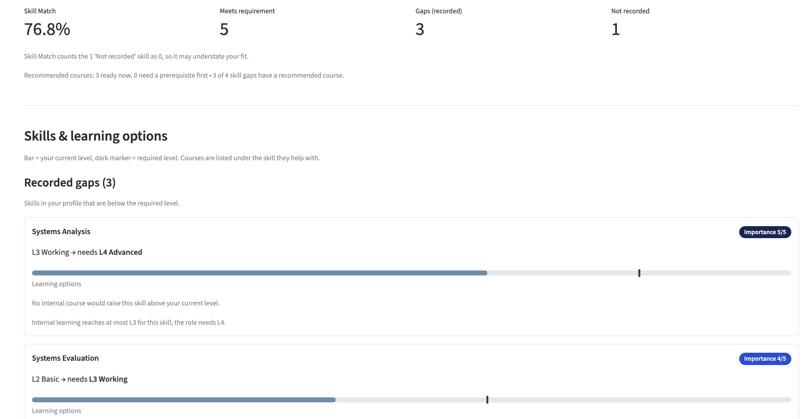
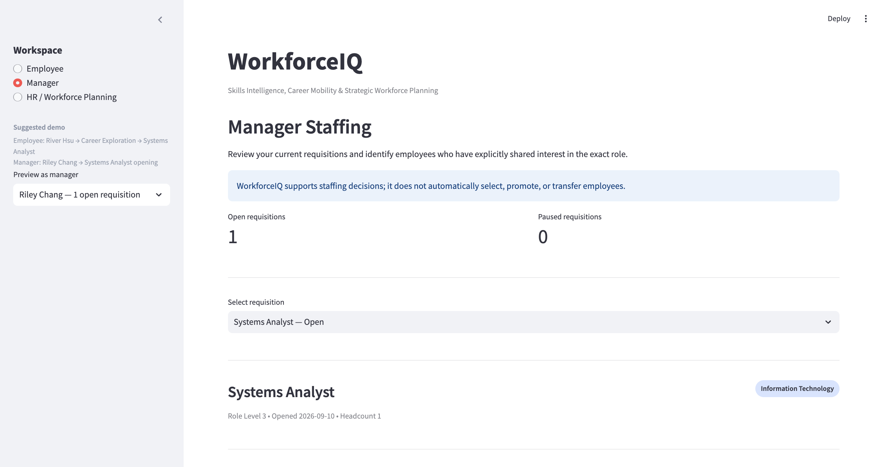
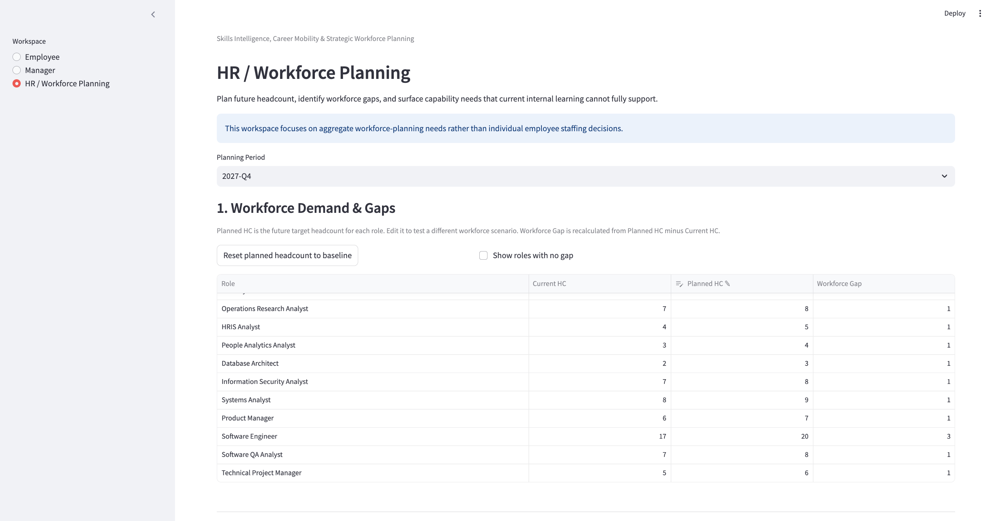
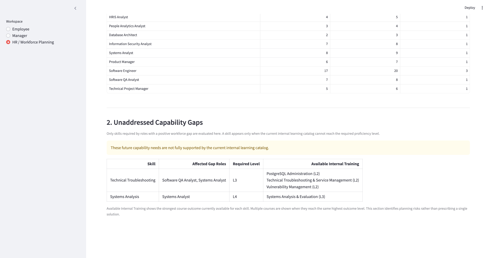
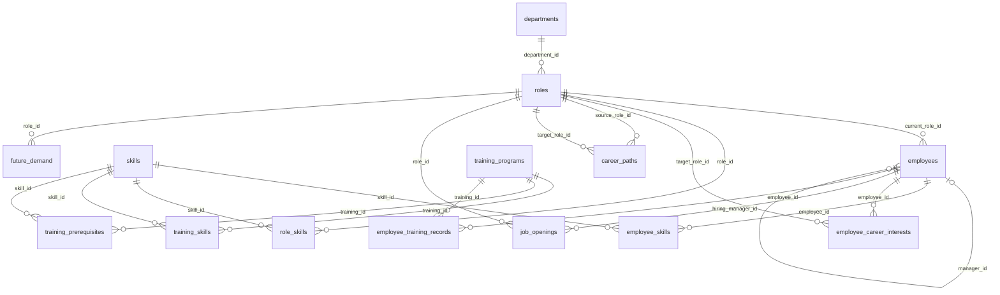

# WorkforceIQ

[English](README.md) | 繁體中文

[](https://github.com/harper-chen/WorkforceIQ/actions/workflows/tests.yml)

一個人力決策輔助系統，把員工的技能、職涯意向與培訓，和職缺及未來人力規劃連結起來，讓組織在對外招募之前，先從內部培養人才，同時不把決定權從人的手中拿走。

**[試用線上 Demo →](https://workforceiq-demo.streamlit.app/)** 不需要註冊。先從 River Hsu（員工）開始，再看 Riley Chang（主管）；詳見[試用 Demo](#試用-demo)。

<p align="center">
  <a href="https://workforceiq-demo.streamlit.app/"></a>
</p>

<p align="center"><em>主管畫面：一位選擇分享職涯意向的員工，附上準備度標籤與建議的補人路徑。</em></p>

## 問題

這個想法來自我在一家培訓制度完善的大型電子公司實習時的觀察。我注意到三個互相脫節的地方：

1. **培訓看不到會通往哪裡。** 員工上課、提升技能，但課程目錄回答的是「這堂課會教我什麼？」，而不是「這能幫我準備哪個職位？我離那個職位還有多遠？」
2. **內部人才很容易被忽略。** 當技能、職涯意向和職缺分散在不同地方，公司可能會對外招募，即使內部已經有員工只要經過針對性培訓就能勝任。
3. **分享職涯意向讓人有顧慮。** 如果主管看得到所有內容，想探索其他團隊的員工可能就不敢使用職涯工具。

## 這個專案改變了什麼

| | 以前 | 使用 WorkforceIQ |
|---|---|---|
| **員工** | 知道課程會教什麼，但不知道它能帶自己去哪裡 | 看到自己已記錄的技能與目標職位的符合程度、還有哪些差距，以及哪些內部課程能補上 |
| **主管** | 補人時不知道內部有誰有興趣、又夠接近 | 看到選擇向該職缺分享意向的員工，每人附上準備度標籤，以及建議路徑：內部調動、需要更多資料，或對外招募 |
| **HR** | 人力規劃和培訓規劃分開進行 | 看到哪些職位將會缺人，以及哪些必要技能是現有培訓目錄完全無法培養的 |
| **隱私** | 對其他職位的興趣不是完全隱藏，就是完全曝光 | 職涯意向預設為私人；只有員工選擇公開，且符合該主管負責的開放職缺時，主管才看得到 |

這個 app 從不升遷、調動、錄用或拒絕任何人。它把分散的資訊整合起來並說明建議的理由；做決定的是人。

## 我做了什麼

WorkforceIQ 從資料模型到介面，都是我獨立設計與開發的，過程中也使用了 AI 程式助手，例如協助撰寫自動化測試：

- **14 張資料表的關聯式資料庫**（員工、技能、職位、培訓、職涯意向、職缺、未來人力需求），填入 100 位員工、16 個職位、98 項技能和 67 個培訓課程的模擬資料，每次重建都會做完整性檢查。
- **透明的配對與準備度規則**，用 SQL 和 Python 撰寫，並和介面分開，讓每一條規則都能單獨測試。
- **三個 Streamlit 工作區**，分別給員工、主管和 HR，隱私規則直接寫在資料庫查詢裡。
- **111 個自動化測試**，每次 push 都會在 Python 3.11 和 3.12 上執行，包含用人工算好答案的配對計算範例，以及每個準備度門檻的邊界值。

## 運作方式

Demo 用同一個故事串起三個工作區。

**1. 員工探索下一個職位。** 商業分析師 River Hsu 打開 Career Exploration，看到推薦的下一步職位（從他目前職位出發的正式職涯路徑排在前面），以及他已記錄的技能與每個職位的符合程度。



**2. 他看到差距，以及如何補上。** 詳細頁面把真正的技能差距，和只是尚未記錄的技能分開，並把每個差距連到內部課程（含先修條件）。他已把 Systems Analyst 存為職涯意向，並設為向職缺主管公開；他的另一個意向 BI Analyst 則維持私人。



**3. 主管檢視職缺。** Riley Chang 有一個開放中的 Systems Analyst 職缺。



**4. 系統建議先從內部找。** 因為 River 分享了意向，Riley 看到他的準備度是 `Train First`，建議路徑是 `Internal Mobility`。決定權仍在 Riley 手上。


**5. HR 看到整體情況。** HR 調整規劃人數，看出哪些職位將會缺人。



**6. HR 檢查培訓能否補上差距。** 系統列出沒有任何內部課程能教到職位所需程度的技能，以及受影響的職位。



## 設計選擇

每一項設計都來自我想讓系統避開的一個風險：

- **沒有資料不等於能力不足。** 技能沒有記錄時，畫面顯示 `Not recorded`，而不是當成差距或待加強的技能。當記錄太少而無法判斷（低於職位必要技能的 70%），或光是缺少的記錄就可能改變結果時，準備度會是 `Not assessed`，路徑可能變成 `More Evidence Needed`，而不是建議對外招募。課程的先修技能沒有記錄時，課程不會被鎖住，而是請員工先確認。
- **一項強項不能掩蓋另一項差距。** 每項技能最多只算到該要求的 100%，所以某項技能特別強，也不會抵銷另一項技能的不足。
- **預設保護隱私，分享由員工決定。** 職涯意向預設為私人。主管只看得到員工選擇分享的內容，而且只限於自己負責的開放職缺的同一職位；HR 規劃只看彙總資料。
- **不用排名替人做決定。** 候選人清單的排序只是為了方便閱讀，真正有意義的是準備度標籤和說明，系統不會替人做決定。
- **刻意選擇規則而不是機器學習。** 模擬資料沒有真實的結果（例如成功的內部調動）可以用來訓練或驗證模型。在現有證據下，任何人都能讀懂、質疑的規則比較誠實。

## 試用 Demo

1. 打開**[線上 Demo](https://workforceiq-demo.streamlit.app/)**，選擇 **Employee** 工作區和 **River Hsu**，在 **My Skills** 檢視他的技能。
2. 打開 **Career Exploration**，選擇 **Systems Analyst**，查看符合程度、差距和建議課程。
3. 切換到 **Manager** 工作區，選擇 **Riley Chang**，檢視開放中的 Systems Analyst 職缺和 River 的準備度。
4. 切換到 **HR / Workforce Planning**，修改幾個規劃人數，並查看能力差距。

每位訪客都使用自己的資料庫副本，所以你的變更不會影響其他人。**Demo controls → Reset demo data** 可以還原到初始狀態。

## 限制

WorkforceIQ 是原型。

- **模擬資料：** 人力資料是虛構的，無法呈現真實組織的情況。
- **門檻未經驗證：** 準備度門檻是合理的預設值，尚未用真實的內部調動結果校準。
- **沒有真正的登入：** 在員工、主管、HR 之間切換只是為了展示，沒有正式的身分驗證或角色權限控管。
- **測試涵蓋邏輯，不涵蓋畫面：** 規則、隱私查詢和資料庫重建都有自動化測試；Streamlit 畫面是人工檢查。
- **Demo 資料是暫時的：** 重新整理頁面或主機重啟時，會從初始資料重新建立副本。

## 技術細節

使用 Python、pandas、SQL、SQLite 和 Streamlit 打造。

<details>
<summary>技能配對與準備度規則</summary>

**Skill Match。** 每項必要技能：

```text
min(員工程度 / 要求程度, 1)
```

整體 Skill Match，依每項技能對職位的重要性加權：

```text
Σ(重要性 × 單項符合度)
-----------------------
Σ(重要性)
```

沒有記錄的技能在計算中得 0 分，但介面會標示為 `Not recorded`，不計入差距，也不計入待加強的技能。因為 0 分只會拉低分數，系統另外計算**最佳情況的 Skill Match**：假設每項沒有記錄的技能都達到要求。

**證據覆蓋率**是員工有記錄的必要技能占職位必要技能的比例（不依重要性加權）。

**內部準備度**（原型預設值，見 `app/readiness.py`）：

| 準備度 | 證據覆蓋率 | Skill Match | 優先差距 | 顯著差距 |
|---|---:|---:|---:|---:|
| Ready Now | ≥ 70% | ≥ 80% | 0 | ≤ 1 |
| Train First | ≥ 70% | ≥ 60% | ≤ 1 | 無上限 |
| Larger development gap | ≥ 70% | 不符合以上條件 | — | — |
| Not assessed | < 70% | 不評估 | — | — |

**顯著差距**是有記錄、但比要求低 2 級以上的技能；**優先差距**是發生在職位最重要技能（重要性 4–5）上的顯著差距。沒有記錄的技能不會被算成這兩種差距。

證據覆蓋率達 70% 以上時，準備度會檢查兩次：一次用已記錄的 Skill Match，一次用最佳情況的 Skill Match（兩次的差距都只計算有記錄的技能）。如果兩個結果不同，代表是缺少的記錄在決定結果：

- 依已記錄技能是 Larger development gap，但最佳情況是 Train First 以上 → `Not assessed`。
- 依已記錄技能是 Train First，但最佳情況是 Ready Now → 維持 `Train First`，並註明補上記錄後可能是 Ready Now。

**職缺的補人路徑：**

- **Internal Mobility：** 至少一位可見候選人是 `Ready Now` 或 `Train First`。
- **More Evidence Needed：** 沒有候選人符合，但至少一位是 `Not assessed`（記錄太少，或缺少的記錄可能改變結果）。
- **External Hire：** 所有可見候選人都已評估且無人符合，或沒有員工對該職位分享意向。

可見候選人依 Skill Match 排序，接著是優先差距較少、顯著差距較少者。主管暫停中的職缺會列出，但在重新開放前無法搜尋候選人。

</details>

<details>
<summary>隱私與存取模型</summary>

職涯意向只有在以下條件全部成立時，才會出現在主管的候選人清單中（寫在 `app/db.py` 的 SQL 查詢裡，並有測試涵蓋）：

- 員工把可見度設為 `opening_managers`
- 目標職位與職缺的職位完全相同
- 職缺屬於目前這位主管
- 職缺狀態是 `open`
- 該員工不是職缺的招募主管本人

這是原型：工作區切換只是為了展示，沒有正式的身分驗證或角色權限控管。

</details>

<details>
<summary>人力規劃計算</summary>

每個職位依 HR 輸入的規劃人數計算：

```text
人力缺口 = max(規劃人數 - 目前人數, 0)
```

學習覆蓋檢查會把**所有**職位的需求和培訓目錄比對。系統找出每項必要技能在內部課程中能教到的最高程度；如果低於某職位的要求，就列為能力差距，並列出受影響的職位。這項檢查不受人數情境影響。邏輯在 `app/planning.py`。

</details>

<details>
<summary>資料模型</summary>

資料庫共有 14 張表。以下總覽由 `database/schema.sql` 產生：



各區域的欄位圖在 [`docs/er-diagram.md`](docs/er-diagram.md)，[`docs/schema.dbml`](docs/schema.dbml) 可以貼到 [dbdiagram.io](https://dbdiagram.io)。用 `python database/generate_er_diagram.py` 重新產生；如果圖和 schema 不一致，測試會失敗。

</details>

<details>
<summary>自行執行、資料庫重建與訪客專屬副本</summary>

```bash
pip install -r requirements.txt
python database/rebuild_db.py            # 從 schema 和種子檔建立 demo 資料庫
streamlit run app/app.py
python -m unittest discover -s tests     # 執行自動化測試
```

SQLite 資料庫沒有放進 repo。如果 `database/workforceiq.db` 不存在，app 第一次啟動時會從 schema 和種子檔自動建立。

- `python database/rebuild_db.py --dry-run`：驗證重建流程，但不取代現有資料庫。
- `python database/rebuild_db.py --keep-interests`：重建時保留已儲存的職涯意向。
- 取代現有資料庫前會先備份。
- 每次重建都會檢查資料庫完整性、外鍵、重要的 schema 限制和種子資料一致性。

重建出的資料庫是唯讀的基準：執行中的 app 從不寫入它。每個訪客 session 都有自己的暫存副本，所以在一個分頁儲存職涯意向，不會影響其他人。閒置約一天後副本會被刪除。

</details>

<details>
<summary>自動化測試</summary>

| 範圍 | 檢查內容 |
|---|---|
| Skill Match 與差距 | 加權符合度、單項 100% 上限、差距與優先差距數量，以及沒有記錄的技能得 0 分但不計入差距；用一個答案以人工算好的小型資料庫驗證 |
| 主管可見度 | 只顯示員工設為可見、且是該主管負責的開放職缺同一職位的意向；私人意向、其他職位、暫停的職缺和招募主管本人都會被排除 |
| 準備度與補人路徑 | 每個門檻的邊界值、每一種補人路徑，以及避免缺少的記錄決定結果的最佳情況檢查 |
| 課程先修條件 | 有記錄但低於最低要求的先修技能會鎖住課程；沒有記錄的只會請員工先確認 |
| 人力規劃 | `max(規劃 − 目前, 0)`，以及哪些必要技能是培訓目錄無法涵蓋的 |
| 訪客專屬資料庫 | 每位訪客的副本各自獨立、儲存和重置互不影響，以及舊副本的清除 |
| 種子 Demo | 資料庫重建時所有完整性檢查都通過，而且 Demo 故事（River Hsu → Riley Chang → `Internal Mobility` / `Train First`）依然成立 |
| 文件 | ER 圖與 `schema.sql` 一致，`SQL/` 裡的範例查詢也都能執行 |

</details>

<details>
<summary>專案結構</summary>

```text
WorkforceIQ/
├── app/
│   ├── app.py
│   ├── db.py              # SQL 查詢與訪客專屬資料庫副本
│   ├── readiness.py       # 證據覆蓋率、內部準備度、補人路徑
│   ├── planning.py        # 人力缺口與學習覆蓋計算
│   └── views/             # 員工、主管、HR 畫面
├── database/
│   ├── schema.sql
│   ├── seed_*.sql
│   ├── rebuild_db.py
│   └── generate_er_diagram.py
├── tests/
├── docs/
│   ├── er-diagram.md
│   ├── schema.dbml
│   └── images/
├── SQL/
├── .github/workflows/tests.yml
└── requirements.txt
```

</details>
