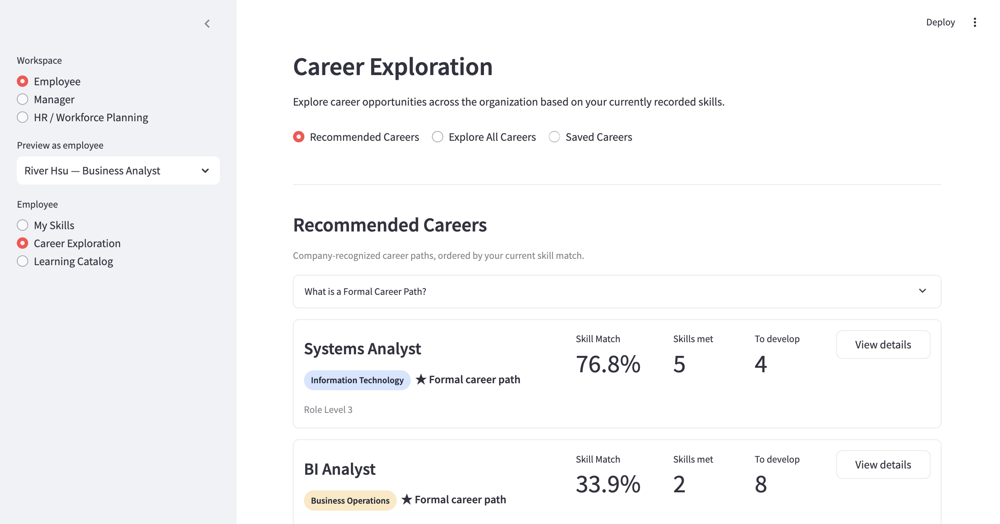
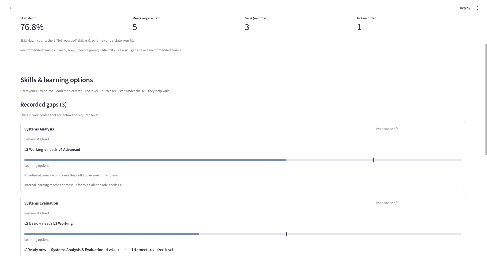
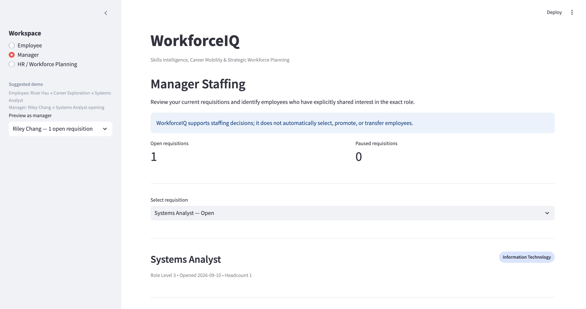
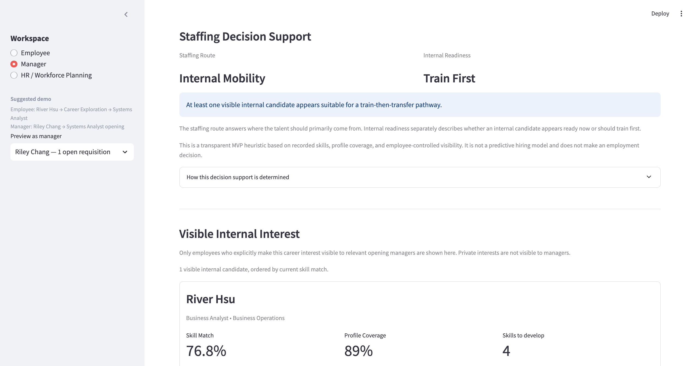
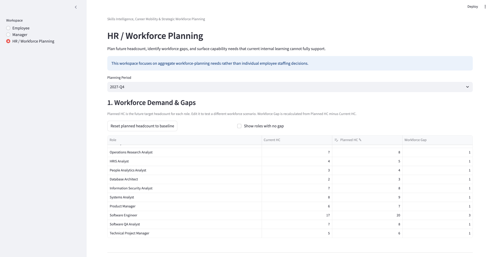
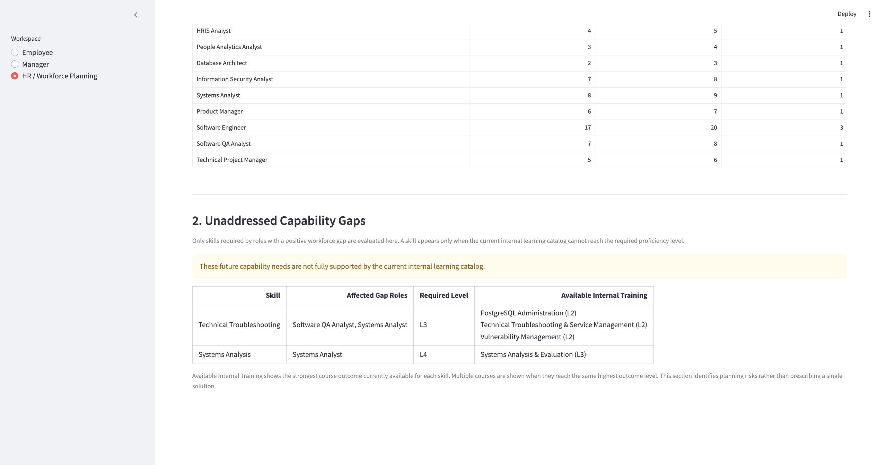

# WorkforceIQ

[English](README.md) | 繁體中文

**WorkforceIQ 是一個以人為中心的 workforce decision-support system，整合員工技能、職涯意向、內部學習資源、職務需求與未來人力需求。**

它主要協助三種角色回答彼此相關、但不同層次的問題：

- **Employee：** 我下一步可以往哪些職務發展？
- **Manager：** 這個 staffing need 是否有機會先透過 internal mobility 解決？
- **HR / Workforce Planning：** 未來哪些職務可能缺人，而公司目前的 learning resources 是否足以支撐這些能力需求？

這個系統不會替企業自動做升遷、轉調、錄用或解僱決策，而是把原本分散的 workforce data 連接起來，提供透明、可解釋且可行動的 decision support。

WorkforceIQ 目前使用 **synthetic enterprise workforce data**，以 Python、Pandas、SQL、SQLite 與 Streamlit 建構。

## Quick Start

```bash
pip install -r requirements.txt
python database/rebuild_db.py      # 從 schema 與 seed files 建立 demo database
streamlit run app/app.py
```

## Why WorkforceIQ?

企業內與人才相關的資訊通常分散在不同系統中，例如：

- Employee skill profiles
- Role requirements
- Career interests
- Internal training programs
- Job openings
- Future headcount plans

這些資料各自有價值，但很多 workforce decisions 真正依賴的是它們之間的關係。

例如，只知道某個 role 未來需要增加 headcount 並不夠。Manager 還需要知道是否有感興趣的內部員工已經接近 role requirements；HR 也需要知道現有 learning catalog 是否真的能培養未來缺口職務所需要的能力。

WorkforceIQ 將這些資訊整合到同一個 decision-support workflow 中。

## Demo Scenario

若要完整體驗 prototype，建議依照以下流程：

1. **Employee：** 先以 **River Hsu — Business Analyst** 進入 **My Skills**，查看目前已記錄的 skill profile。
2. 進入 **Career Exploration**，選擇 **Systems Analyst**，查看 Skill Match、skill gaps 與 learning options。
3. 切換到 **Manager**，選擇 **Riley Chang**，查看 open 的 **Systems Analyst** requisition，以及 River 的 internal readiness。
4. 最後進入 **HR / Workforce Planning**，查看 Systems Analyst 如何出現在未來 workforce demand 與 capability-gap planning 中。

這條 walkthrough 將 Employee、Manager 與 HR 三個視角串在同一個 workforce scenario 中。

## What the System Supports

### Employee：Skills、Career Exploration 與 Learning

Employee workspace 幫助員工了解目前的能力狀態、探索未來可能的職涯方向，以及找到可以補強 skill gap 的內部學習資源。

在 **My Skills** 中，員工可以查看：

- Current role
- 已記錄的 skills
- Proficiency levels

如果某項 skill 沒有紀錄，系統會顯示：

`Not recorded`

而不是直接解讀為員工不具備該能力。

在 **Career Exploration** 中，系統會比較員工目前的 skill profile 與 target role requirements，並顯示：

- Overall Skill Match
- 已達到 role requirement 的 skills
- Recorded skill gaps
- 尚未記錄的 skills
- 對應的 internal learning options

員工也可以儲存有興趣的 career role。

Career interest 預設為 `Private`。員工可以主動選擇 `Visible to opening managers`。

在目前的 prototype 中，只有負責該 exact target role 之 **open requisition** 的 manager，才會在 staffing view 中看到這項 interest。

**Learning Catalog** 則整合內部 training programs，讓員工查看各課程涵蓋的 skills、可達到的 proficiency level，以及 training prerequisites。

### Manager：Internal Staffing Decision Support

Manager workspace 不會自動排名或選出候選人。

它主要協助回答：

> 這個 staffing need 是否值得優先透過 internal mobility 處理？

Manager 名下 `open` 與 `paused` 的 requisitions 都會列出，但 `paused` requisition 在恢復為 `open` 之前，不提供 internal candidate search。

對於主動把 career interest 設為可見的員工，WorkforceIQ 會評估：

- Skill Match
- Skill-profile evidence coverage
- Significant gaps
- Priority gaps

#### Evidence Coverage

Evidence coverage 代表員工在該 target role 所需技能中，有多少技能已有紀錄：

```text
有紀錄的必要技能數
------------------
必要技能總數
```

Coverage 不使用 skill importance 加權。

#### Internal Readiness

目前 prototype 使用以下 heuristic defaults：

| Readiness | Evidence coverage | Skill Match | Priority gaps | Significant gaps |
|---|---:|---:|---:|---:|
| Ready Now | ≥ 70% | ≥ 80% | 0 | ≤ 1 |
| Train First | ≥ 70% | ≥ 60% | ≤ 1 | No explicit cap |
| Larger development gap | ≥ 70% | 未符合 Ready Now 或 Train First 條件 | — | — |
| Not assessed | < 70% | Not assessed | — | — |

即使 Skill Match 達到其中一項分數門檻，若其他 readiness 條件未滿足，例如 priority gaps 過多，候選人仍可能被歸為 `Larger development gap`。

這些門檻屬於 **prototype-level heuristic defaults**，目前尚未以真實 internal-mobility outcomes 進行驗證或 calibration。

#### Staffing Route

Manager 最後會看到三種 staffing route。

**Internal Mobility**

當至少有一位可見候選人達到 `Ready Now` 或 `Train First` 時，系統會建議優先考慮 internal mobility。

**More Evidence Needed**

如果目前沒有候選人達到 `Ready Now` 或 `Train First`，但至少有一位候選人的 skill evidence 不足以完成可靠的 readiness assessment，系統會建議 `More Evidence Needed`。

這能避免把「缺少資料」直接解讀成「員工不適合」。

**External Hire**

只有在所有可見候選人都有足夠 skill evidence，且沒有任何候選人達到 `Ready Now` 或 `Train First` 時，系統才會建議 `External Hire`。

如果沒有任何員工對該 exact role 表達可見的 career interest，也會建議 `External Hire`。

### HR：Workforce Planning 與 Learning Coverage

HR workspace 維持在 aggregate level，而不是進行個別 candidate evaluation。

它主要回答兩個問題。

#### 哪些職務未來可能出現 workforce gap？

系統比較 Current Headcount 與 Planned Headcount，並計算：

```text
Workforce Gap = max(Planned Headcount - Current Headcount, 0)
```

HR 可以調整 planned headcount，觀察不同 roles 的未來 staffing needs 如何變化。

#### 現有 internal learning 是否足以支撐這些未來職務？

對具有 workforce gap 的 roles，WorkforceIQ 會把 workforce demand、role skill requirements 與 internal training catalog 串接起來：

```text
Gap Roles
→ Role Skill Requirements
→ Internal Training Coverage
→ Capability Development Priorities
```

對每一項 required skill，系統會找出目前 internal training catalog 可提供的 **最高 training outcome level**。

如果這個 level 仍低於 gap role 所要求的 proficiency level，該 skill 就會被列為 capability development priority。

這讓 workforce planning 不只回答：

> 哪些職務可能缺人？

也能進一步回答：

> 公司目前的 internal learning system 是否有能力培養這些未來職務需要的能力？

## Screenshots

### Employee — Career Exploration

River Hsu 從 Business Analyst 出發，探索 Systems Analyst。Overview 顯示推薦職涯選項與目前的 skill fit。



Role-detail view 會把 recorded gaps 與 missing evidence 分開呈現，並把 development needs 連結到可用的 internal learning options。



### Manager — Internal Staffing

Riley Chang 檢視一個 open 的 Systems Analyst requisition。



WorkforceIQ 將 River Hsu 顯示為可見的 internal candidate，並根據目前已記錄的 evidence，建議 `Internal Mobility` / `Train First` pathway。



### HR — Workforce Planning

HR 比較 Current Headcount 與 Planned Headcount，以辨識未來 workforce gaps。



接著，系統會標示目前 internal learning catalog 尚無法充分支撐的 capability needs。



## Skill Matching Logic

WorkforceIQ 使用透明、rule-based 的 matching approach。

每一項 skill：

```text
min(employee proficiency / required proficiency, 1)
```

整體 Skill Match：

```text
Σ(importance × skill match)
---------------------------
Σ(importance)
```

其中有兩個重要原則。

### Overperformance does not cancel another gap

某一項 skill 高於職務要求，不會補償另一項能力不足。

因此，每一項 skill 對整體 match 的貢獻最高為 100%。

### Lack of evidence is not evidence of lack

如果員工沒有某項 required skill 的紀錄，matching calculation 會給予該 skill 0 demonstrated match credit。

但 UI 仍會顯示：

`Not recorded`

這個區分很重要，因為「缺少 evidence」和「有 evidence 顯示能力不足」並不是同一件事。

## Human-Centered Design Principles

WorkforceIQ 的設計目標是支援 human judgment，而不是取代它。

**Employee agency**  
員工自行決定是否讓自己的 saved career interests 對 opening managers 可見。

**Data minimization**  
Manager 只會看到與自己負責的 staffing need 有關，而且由員工主動選擇公開的 career interests。HR workforce planning 則維持在 aggregate level。

**Explainability**  
Skill Match、skill gaps、readiness 與 staffing routes 都來自明確、可追溯的 rule-based logic。

**Human oversight**  
系統不會自動進行升遷、轉調、錄用、拒絕或解僱。最終決策仍由人負責。

**Evidence-aware decisions**  
當資料不足時，系統可以輸出 `Not assessed` 或 `More Evidence Needed`，而不是強迫產生看似精確的判斷。

## Current Privacy and Access Model

目前的 visibility rules 是透過以下方式實作：

- Database queries
- Application logic
- UI flow

Career interest 要出現在 manager candidate list 中，必須同時符合：

- 員工將 visibility 設為 `opening_managers`
- Career interest 的 target role 與 opening role 完全相符
- 該 opening 屬於目前的 manager
- Opening status 為 `open`
- 員工不是該 opening 的 hiring manager 本人

目前仍是 prototype。

系統**尚未**實作 production-grade authentication、authorization 或 role-based access control。

因此 sidebar 中的 Employee、Manager 與 HR workspace switcher 僅用於 development 與 demonstration。

## Technical Architecture

主要技術：

- Python
- Pandas
- SQL
- SQLite
- Streamlit

主要資料實體包括：

- Departments
- Roles
- Skills
- Employees
- Employee skills
- Role skill requirements
- Career interests
- Career paths
- Job openings
- Training programs
- Training prerequisites
- Training records
- Future workforce demand

專案結構：

```text
WorkforceIQ/
├── app/
│   ├── app.py
│   ├── db.py
│   └── views/
│
├── database/
│   ├── schema.sql
│   ├── seed_*.sql
│   └── rebuild_db.py
│
├── docs/
│   └── images/
│       ├── employee-career-overview.png
│       ├── employee-career-detail.png
│       ├── manager-opening.png
│       ├── manager-staffing-decision.png
│       ├── hr-workforce-demand.png
│       └── hr-capability-gaps.png
│
├── SQL/
└── requirements.txt
```

## Reproducible Database

產生後的 SQLite database 不直接 commit 到 repository。

如果 `database/workforceiq.db` 不存在，application 會自動從已 commit 的 schema 與 seed files 建立一份新的 demo database。這讓全新的 portfolio deployment 不需要把可寫入的 SQLite database commit 到 repository，也能直接啟動。

Database 也可以手動重建：

```bash
python database/rebuild_db.py
```

如果只想驗證 rebuild process，而不替換現有 database：

```bash
python database/rebuild_db.py --dry-run
```

如果希望 rebuild 時保留既有 saved career interests：

```bash
python database/rebuild_db.py --keep-interests
```

如果已有既有 database，正式 rebuild 前會先建立 backup。Public demo 另外提供 **Demo controls → Reset demo data**，可以把 career interests 與 visibility settings 恢復成 seeded demo state，而且不會另外建立 backup。

Rebuild script 也會檢查：

- Database integrity
- Foreign-key consistency
- Key schema constraints
- Seed-data consistency

## Why Rule-Based Instead of Machine Learning?

WorkforceIQ 目前使用 rule-based decision logic，而不是 predictive machine learning。

這不是因為 machine learning 本身不適合 workforce analytics。

目前專案使用 synthetic workforce data，而且沒有真實的 historical outcomes，例如：

- Internal-mobility success
- Hiring outcomes
- Longitudinal employee performance

因此，目前沒有可靠的 prediction targets 或 validation labels。

即使建立 predictive model，也沒有合理的方法判斷它是否真的能預測 employee readiness 或 successful internal mobility。

在目前 prototype 階段，使用可直接檢查、可討論的透明規則，比建立無法驗證的 predictive model 更符合現有 evidence base。

如果未來能取得足夠、且經過適當 governance 的 real historical data，才有條件進一步比較 rule-based、statistical 與 machine-learning approaches。

## Limitations

WorkforceIQ 目前仍是一個 prototype。

主要限制包括：

- **Synthetic data：** 目前 workforce data 為 synthetic demo data，不能用來推論真實企業的人才分布或 workforce outcomes。
- **Heuristic thresholds：** Readiness thresholds 尚未透過真實 mobility outcomes 驗證或 calibration。
- **No production authentication or RBAC：** 不同 workspace 的 visibility 目前由 query logic、application logic 與 UI flow 控制，而非 production-grade access control。
- **No outcome validation：** 目前沒有真實 mobility、hiring 或 performance labels，因此無法驗證 staffing rules 的 predictive validity。
- **No automated application test suite：** Database rebuild 包含 integrity 與 consistency checks，但 application-level behavior 目前主要透過 manual QA 驗證。
- **Prototype deployment：** 目前系統主要作為 local / portfolio prototype，而不是 production HR platform。

## Project Scope

WorkforceIQ 目前聚焦於：

- Workforce data integration
- Skills intelligence
- Career mobility
- Internal staffing
- Workforce planning
- Learning coverage
- Explainable decision support
- Human-in-the-loop decision support

目前刻意不把系統擴展成完整 HRIS，也不加入無法用現有資料驗證的 predictive features。

專案的核心問題不是：

> 「能不能加入更多 AI？」

而是：

> **在現有 evidence 下，系統能提供哪些透明、可解釋，而且不會做出超出資料所能支持之主張的 decision support？**
