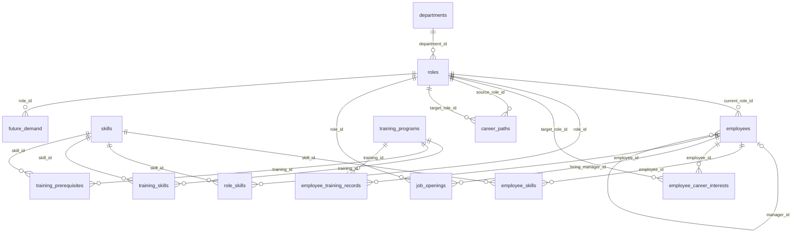
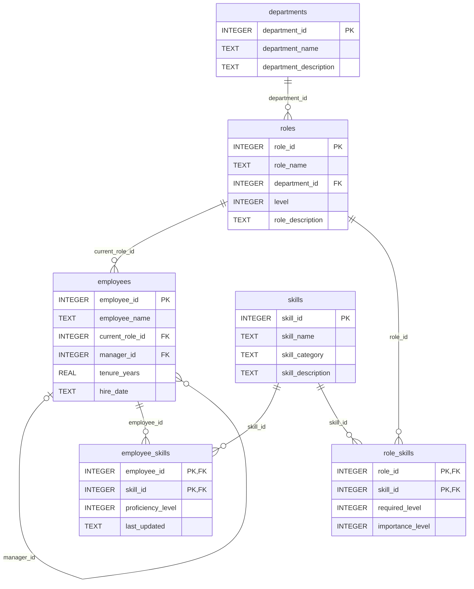
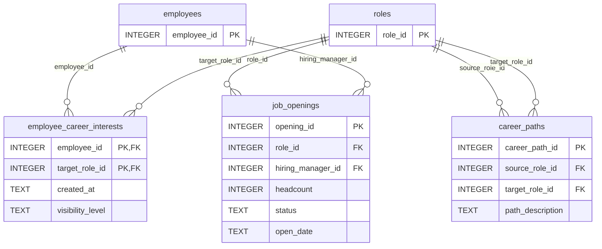
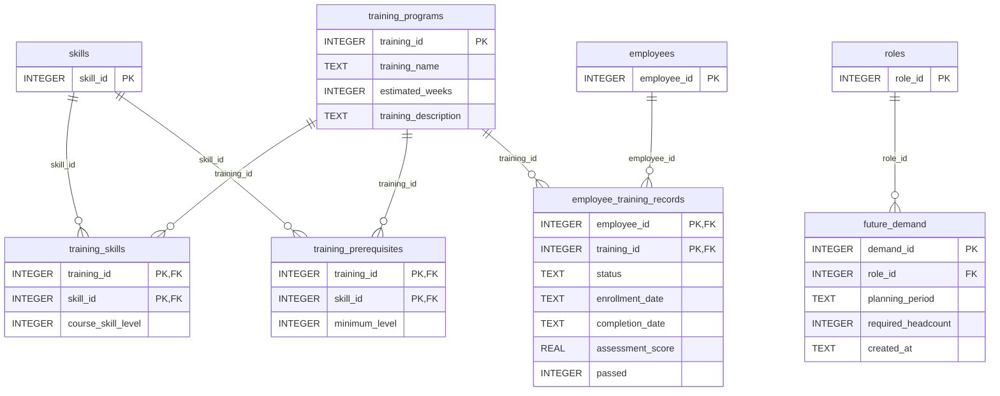

# Data model

<!-- Generated by database/generate_er_diagram.py from database/schema.sql. Do not edit by hand. -->

WorkforceIQ stores its data in 14 SQLite tables. The diagrams below are generated from `database/schema.sql`, so they always match the real schema.

In each diagram, `PK` marks a primary key and `FK` a foreign key. A line reads "one parent row has zero or more child rows". The label on the line is the foreign-key column; a nullable foreign key (for example `employees.manager_id`) uses a "zero or one" parent end.

For a polished, shareable image, paste [`docs/schema.dbml`](schema.dbml) into [dbdiagram.io](https://dbdiagram.io).

## Overview

All tables and how they relate.

## Organization and skills

Who works where, which skills exist, what each role requires, and what each employee has recorded.

## Career interests and staffing

Employee-controlled career interests, possible career paths, and manager-owned job openings.

## Learning and workforce planning

The internal training catalog, who has completed what, and planned future headcount by role.

## Rules enforced by the database

Beyond keys, the schema enforces these rules with `CHECK` constraints:

- Skill proficiency, required level, importance and course level are integers from 1 to 5.
- Career-interest visibility is `private` or `opening_managers`.
- A job opening is `open`, `paused`, `filled` or `closed`, and its headcount is positive.
- A career path cannot point a role at itself.
- A completed training record needs a completion date and `passed = 1`; enrolled, in-progress and withdrawn records must have neither.
- Future required headcount cannot be negative; each role has at most one row per planning period.
